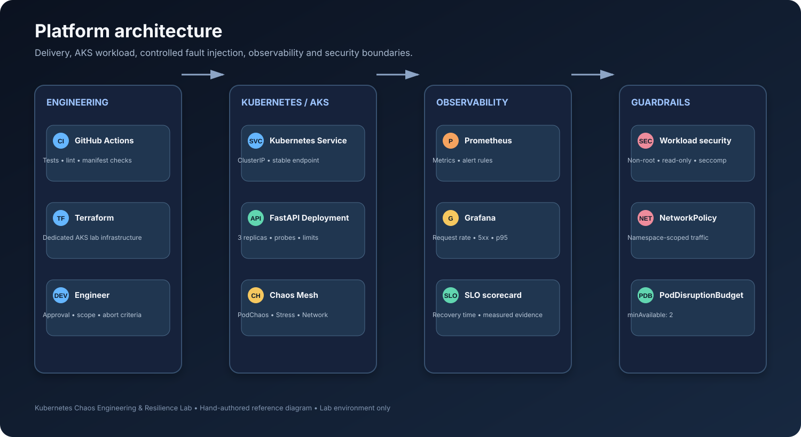
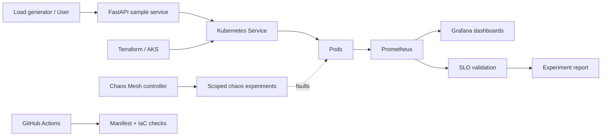

<div align="center">

# Kubernetes Chaos Engineering & Resilience Lab

**Prove resilience before incidents prove otherwise.**

A production-minded chaos engineering reference platform for Kubernetes and Azure Kubernetes Service (AKS). Run controlled failure experiments, measure service-level objectives, verify recovery, and turn resilience findings into actionable engineering work.


[Architecture](docs/architecture.md) · [Diagram source files](docs/diagrams/README.md) · [Quick Start](docs/getting-started.md) · [Experiments](docs/experiments.md) · [Runbooks](docs/runbooks/) · [Security](docs/security.md) · [50 Interview Q&A + Scenarios](docs/interview-prep/50-questions-and-real-world-scenarios.md)

</div>



[Open the editable diagrams.net source files](docs/diagrams/README.md) · [Icon sources and attribution](assets/icons/README.md)


## Executive overview

This repository demonstrates how a DevSecOps / SRE team can continuously validate Kubernetes workload resilience without experimenting on production systems. It combines an observable sample application, controlled fault injection, SLO-based evaluation, infrastructure-as-code patterns, and CI guardrails.

**Engineering question:** when a pod disappears, CPU becomes constrained, or network latency increases, does the workload recover within its reliability objectives—and can the team prove it with telemetry?

## Capability map

| Capability | Implementation | Outcome |
|---|---|---|
| Workload | FastAPI service with health/readiness endpoints | Observable target |
| Platform | Kubernetes manifests + AKS Terraform starter | Repeatable lab infrastructure |
| Chaos | Chaos Mesh templates | Controlled pod, CPU and network faults |
| Observability | Prometheus metrics + Grafana dashboard | Availability, latency and error visibility |
| Reliability | SLO definitions and experiment scorecard | Evidence-based assessment |
| Delivery | GitHub Actions validation | Catch invalid changes |
| Security | Least-privilege RBAC patterns, non-root container, policy guardrails | Reduced blast radius |
| Operations | Pre-flight checklist and recovery runbooks | Safe, repeatable execution |

## Reference architecture



See [architecture and design decisions](docs/architecture.md) for trust boundaries, data flow, and deployment topology.

## Quick start — local lab

**Prerequisites:** Docker, kubectl, kind or minikube, and Python 3.12+ for local tests.

```bash
# Build and load the sample image into kind
docker build -t resilience-api:local .
kind create cluster --name resilience-lab
kind load docker-image resilience-api:local --name resilience-lab

# Deploy and verify
kubectl apply -k platform/kubernetes/overlays/local
kubectl -n resilience-lab rollout status deployment/resilience-api
kubectl -n resilience-lab get pods,svc

# Test the API
kubectl -n resilience-lab port-forward svc/resilience-api 8080:80
# In another terminal:
curl -fsS http://127.0.0.1:8080/health
curl -fsS http://127.0.0.1:8080/metrics
```

Detailed setup, Chaos Mesh installation and teardown: [Getting Started](docs/getting-started.md).

## Resilience experiments

The starter includes scoped templates. **Do not apply chaos experiments to production.** Install Chaos Mesh only in a disposable lab cluster and review every manifest before execution.

| Experiment | Failure mode | Expected control | Success evidence |
|---|---|---|---|
| Pod kill | Target pod termination | Replicas + readiness probes | Replacement pod Ready; service recovers |
| CPU stress | CPU contention | Requests/limits + autoscaling where configured | Latency and errors stay within SLO |
| Network latency | Added request delay | Timeouts, retries, graceful degradation | Bounded p95 latency and recovery |

Experiment manifests live in [chaos/experiments](chaos/experiments/). Operational gates and abort conditions are documented in [experiments.md](docs/experiments.md).

## Reliability objectives — illustrative lab targets

These are **example objectives**, not measured results or a production commitment.

| Indicator | Example objective | Measurement |
|---|---:|---|
| Availability | ≥ 99.9% | Successful requests / total requests |
| Request latency | p95 ≤ 300 ms | Histogram quantile |
| Error rate | ≤ 0.1% | 5xx responses / total requests |
| Recovery time | ≤ 60 seconds | Fault start to healthy service |

The project does not claim these objectives have passed. Use the experiment scorecard in [docs/experiments.md](docs/experiments.md) to record measured outcomes.

## Repository structure

```text
.
├── .github/workflows/       # CI validation pipeline
├── app/                     # FastAPI service and tests
├── chaos/experiments/       # Scoped Chaos Mesh templates
├── docs/                    # Architecture, setup, SLOs, security, runbooks
├── infra/terraform/         # AKS platform starter
├── monitoring/              # Prometheus rules and Grafana provisioning
├── platform/kubernetes/     # Base manifests and local overlay
├── policies/                # Policy-as-code guardrails
├── scripts/                 # Validation helpers
├── Dockerfile
├── Makefile
└── LICENSE
```

## Engineering principles

1. **Safety before experimentation:** dedicated namespace, bounded duration, manual review and abort criteria.
2. **Measure before and after:** capture baseline, inject one fault, observe, recover, and document.
3. **Least privilege:** no cluster API permissions for the sample workload by default.
4. **Reproducibility:** version-controlled manifests, Terraform, and documented commands.
5. **Honest evidence:** separate design targets from observed measurements; never fabricate test results.

## Roadmap

- [x] Repository structure, architecture and operational principles
- [x] Sample API, probes, metrics and container hardening
- [x] Local Kubernetes deployment and scoped chaos templates
- [x] Terraform AKS starter and CI validation
- [ ] Automated experiment orchestration with approval gates
- [ ] Measured benchmark reports from a real lab run
- [ ] Azure Monitor / Managed Prometheus integration
- [ ] Signed artifacts and advanced policy enforcement

## Portfolio value

Designed to demonstrate skills relevant to **Senior DevSecOps Engineer, SRE, and Cloud Platform Engineer** roles: Kubernetes operations, AKS, Terraform, observability, SLO engineering, controlled failure testing, CI/CD security, and incident readiness.

## Author

**Aamir Haque** · DevSecOps / Cloud Platform Engineering  
GitHub: [@haqueamir70-coder](https://github.com/haqueamir70-coder)

> Educational reference implementation. Review cloud costs, permissions, quotas, and security controls before deploying. Never run fault injection against production or shared clusters without a formal change process and explicit authorization.
