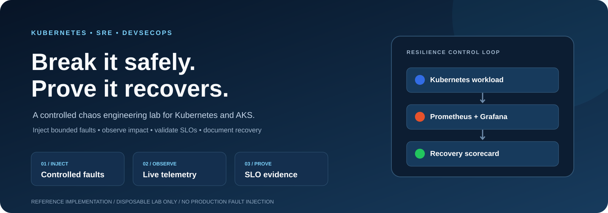
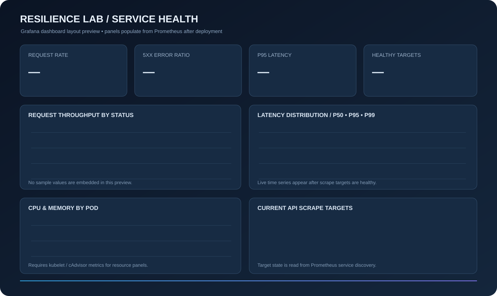

<div align="center">

# Kubernetes Chaos Engineering & Resilience Lab

### Controlled failure. Measurable recovery.

A hands-on Kubernetes and Azure Kubernetes Service (AKS) lab for testing workload resilience through scoped fault injection, Prometheus telemetry, Grafana dashboards and SLO-based recovery evidence.

<p>
<a href="docs/getting-started.md"><strong>Get started</strong></a> ·
<a href="docs/architecture.md"><strong>Architecture</strong></a> ·
<a href="docs/experiments.md"><strong>Run experiments</strong></a> ·
<a href="docs/interview-prep/50-questions-and-real-world-scenarios.md"><strong>Interview guide</strong></a>
</p>


</div>

<p align="center">

</p>

---

## Why this lab exists

A Kubernetes deployment can look healthy until a pod, CPU resource or network path fails. This lab gives engineers a repeatable way to ask a better question:

> **When failure happens, does the service recover within its reliability objectives — and can we prove it?**

It combines an instrumented FastAPI workload, a disposable Kubernetes environment, controlled Chaos Mesh experiments and an evidence-driven reliability workflow. This is an educational reference implementation, not a production chaos platform.

## Engineering capabilities

| Capability | Implementation | Engineering outcome |
|---|---|---|
| Kubernetes | Multi-replica workload, Service, probes and resource controls | Workload lifecycle and recovery behaviour |
| Infrastructure as Code | Terraform starter for a dedicated AKS lab | Repeatable cloud provisioning |
| Chaos engineering | Pod-kill, CPU-stress and network-fault templates | Controlled failure injection |
| Observability | Prometheus metrics and Grafana provisioning | Request rate, errors and latency visibility |
| SRE | SLI/SLO definitions and experiment scorecard | Evidence-based reliability assessment |
| DevSecOps | GitHub Actions validation, container hardening and policy guardrails | Safer delivery practices |
| Operations | Pre-flight checks, abort criteria and recovery runbooks | Repeatable operational execution |

## Architecture

<p align="center">

</p>

**The control loop**

1. **Provision** — Terraform defines the isolated AKS lab; GitHub Actions validates code and infrastructure changes.
2. **Deploy** — the FastAPI service runs behind a Kubernetes Service with three replicas and health probes.
3. **Inject** — an operator runs one reviewed, time-bounded Chaos Mesh experiment against a narrowly selected workload.
4. **Observe** — Prometheus collects request metrics; Grafana exposes service health, error ratio and latency.
5. **Evaluate** — the scorecard compares baseline, fault impact and recovery against stated SLO targets.

Read the [architecture decisions and trust boundaries](docs/architecture.md), or open the [editable diagrams.net sources](docs/diagrams/README.md).

## Quick start — local Kubernetes

The quickest path uses a local kind cluster. No Azure subscription is required for this workflow.

**Prerequisites:** Docker, kind, kubectl and Python 3.12+ for local application tests.

```bash
# Build the sample service
docker build -t resilience-api:local .

# Create a disposable cluster and load the image
kind create cluster --name resilience-lab
kind load docker-image resilience-api:local --name resilience-lab

# Deploy and verify
kubectl apply -k platform/kubernetes/overlays/local
kubectl -n resilience-lab rollout status deployment/resilience-api
kubectl -n resilience-lab get pods,svc
```

Test the service:

```bash
kubectl -n resilience-lab port-forward svc/resilience-api 8080:80
# In another terminal
curl -fsS http://127.0.0.1:8080/health
curl -fsS http://127.0.0.1:8080/metrics
```

For monitoring installation, Chaos Mesh configuration and teardown, follow the [Getting Started guide](docs/getting-started.md).

## Observability and live evidence

The repository includes a provisioned Grafana dashboard, Prometheus scrape configuration and alert rules. Install the local stack using the [Grafana and Prometheus deployment guide](monitoring/INSTALL.md). The dashboard is version-controlled in [monitoring/grafana/dashboards](monitoring/grafana/dashboards/).

<p align="center">

</p>

- [Grafana dashboard JSON](monitoring/grafana/dashboards/resilience-overview.json)
- [Install Prometheus and Grafana](monitoring/INSTALL.md)
- [Prometheus scrape configuration](monitoring/prometheus/prometheus.yml)
- [Prometheus alert rules](monitoring/prometheus/alerts.yml)
- [Chaos experiment templates](chaos/README.md)
- [Experiment evidence status and report template](docs/chaos-evidence.md)

**Evidence integrity:** dashboard definitions and experiment manifests are committed, but no live chaos run or benchmark was executed as part of this repository update. Actual recovery claims require timestamped Grafana/Prometheus evidence from a real lab run.

## Failure scenarios

| Experiment | Injected condition | Expected resilience mechanism | Evidence to capture |
|---|---|---|---|
| Pod termination | A selected pod is terminated | ReplicaSet replacement, readiness and Service routing | Replacement pod Ready; request continuity and recovery time |
| CPU stress | CPU contention on selected workload | Requests/limits and application capacity controls | p95 latency, error ratio and CPU saturation |
| Network fault | Added latency or packet loss | Timeouts, retries and graceful degradation | Request failures, latency impact and recovery |

Templates live in [chaos/experiments](chaos/experiments/). Review [experiment safety gates](docs/experiments.md) before running any fault.

## Reliability objectives

These are **illustrative lab targets**, not measured results, guarantees or claims of passing tests.

| Indicator | Example target | Measurement |
|---|---:|---|
| Availability | ≥ 99.9% | Successful requests / total requests |
| Request latency | p95 ≤ 300 ms | Request-duration histogram |
| Error rate | ≤ 0.1% | 5xx responses / total requests |
| Recovery time | ≤ 60 seconds | Fault start to service recovery |

No pass result is claimed by default. Record actual observations, timestamps, impact and remediation in the [experiment scorecard](docs/experiments.md).

## Safety model

> **Use a disposable, dedicated cluster. Never run the supplied fault experiments against production or shared workloads.**

- Use a dedicated namespace and lab cluster.
- Review every experiment manifest before execution.
- Keep selectors narrow and experiment duration bounded.
- Define abort conditions and a recovery procedure before injecting a fault.
- Restrict Chaos Mesh installation and experiment creation to trusted operators.
- Review Terraform plans, Azure permissions, quotas and expected cost before provisioning.

See the [security model](docs/security.md) and [operational runbooks](docs/runbooks/).

## Repository map

```text
.
├── .github/workflows/       # CI validation
├── app/                     # FastAPI service and tests
├── chaos/experiments/       # Scoped Chaos Mesh templates
├── docs/
│   ├── diagrams/             # SVG previews + editable Draw.io sources
│   ├── interview-prep/       # 50 technical Q&A and scenarios
│   └── runbooks/             # Operational procedures
├── infra/terraform/          # AKS infrastructure starter
├── monitoring/               # Prometheus rules and Grafana provisioning
├── platform/kubernetes/     # Kubernetes base and local overlay
├── policies/                 # Policy guardrails
└── scripts/                  # Validation helpers
```

## Documentation

| Guide | Contents |
|---|---|
| [Getting started](docs/getting-started.md) | Local lab, AKS setup, monitoring and cleanup |
| [Architecture](docs/architecture.md) | Components, data flow, trust boundaries and design decisions |
| [Experiments](docs/experiments.md) | Pre-flight checks, execution gates, SLO evaluation and scorecard |
| [Security](docs/security.md) | RBAC, workload hardening and safety boundaries |
| [Runbooks](docs/runbooks/) | Operational recovery procedures |
| [Interview preparation](docs/interview-prep/50-questions-and-real-world-scenarios.md) | 50 technical questions with practical scenarios |
| [Diagram sources](docs/diagrams/README.md) | Edit diagrams in diagrams.net |
| [Icon attribution](assets/icons/README.md) | Brand asset sources and usage notes |

## Roadmap

- [x] Sample API, health probes, metrics and container hardening
- [x] Local Kubernetes deployment and scoped chaos templates
- [x] AKS Terraform starter and CI validation
- [ ] Automated experiment orchestration with approval gates
- [ ] Publish measured benchmark reports from a completed lab run
- [ ] Azure Monitor / Managed Prometheus integration
- [ ] Signed artifacts and advanced policy enforcement

## About

Built by **Aamir Haque** as a practical DevSecOps / SRE portfolio project.

[GitHub profile](https://github.com/haqueamir70-coder) · [Repository](https://github.com/haqueamir70-coder/kubernetes-chaos-engineering-resilience-lab)

---

<sub>Educational reference implementation. Review cloud costs, permissions, quotas and security controls before deployment. Never inject faults into production or shared clusters without formal authorization and an approved change process.</sub>
