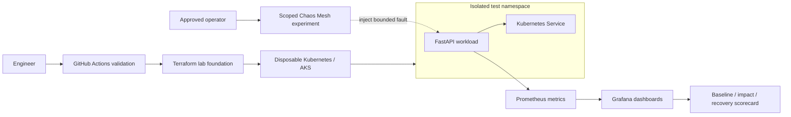
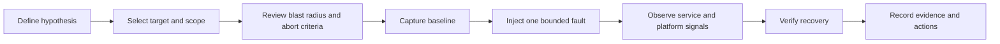

<div align="center">


### Controlled failure · Measurable impact · Evidence-led recovery

[](https://kubernetes.io/)
[](https://learn.microsoft.com/azure/aks/)
[](https://developer.hashicorp.com/terraform)
[](https://prometheus.io/)
[](https://grafana.com/)
[](https://chaos-mesh.org/)

**A Kubernetes SRE lab for testing whether a service survives pod, CPU and network faults — and whether recovery can be demonstrated against explicit service-level objectives.**

[Architecture](#-platform-architecture) · [Experiment model](#-experiment-lifecycle) · [Observability](#-observability) · [Safety controls](#-safety-first)

</div>

> [!IMPORTANT]
> **Execution status:** this repository's documentation, manifests and diagrams are being prepared as a portfolio project. Live cluster deployment and fault injection are on hold until the laptop change. No chaos experiment, benchmark, recovery time or SLO pass is claimed as executed. Do not run experiments against production or shared clusters.

## Why this lab exists

A Kubernetes workload can appear healthy while it is one pod termination or network fault away from an outage. Resilience engineering asks a measurable question:

> When a controlled failure occurs, does the service recover within its reliability objectives — and can the team prove it?

The lab combines a sample FastAPI workload, a disposable Kubernetes environment, scoped Chaos Mesh experiments, Prometheus metrics, Grafana dashboards and a recovery scorecard.

## Platform architecture

<p align="center">
  
</p>



The architecture is a reference design. A diagram or committed manifest is not proof that the corresponding cloud resource or experiment has run.

## Engineering capability map

| Domain | Lab component | Intended evidence |
|---|---|---|
| Kubernetes | Multi-replica API, Service, probes and resource controls | Pod health and rollout state |
| Infrastructure as Code | Terraform starter for dedicated AKS lab | Reviewed plan and deployment record |
| Fault injection | Pod termination, CPU stress and network fault templates | Experiment manifest and bounded execution window |
| Metrics | Prometheus scrape configuration and alert rules | Time-series data during baseline and fault |
| Dashboards | Provisioned Grafana dashboard | Request rate, error ratio, p95 latency and target health |
| SRE | SLI/SLO definitions and experiment scorecard | Measured impact and recovery |
| DevSecOps | GitHub Actions validation and workload hardening | CI results and policy review |
| Operations | Pre-flight checks, abort criteria and runbooks | Repeatable safe execution |

## Experiment lifecycle

<p align="center">
  
</p>



Each experiment must define:
- A falsifiable hypothesis.
- Exact namespace, workload and pod selector.
- Maximum duration and blast radius.
- Expected user impact and SLO abort thresholds.
- Recovery command and named operator.
- Evidence to capture before, during and after injection.

## Failure scenarios

| Scenario | Fault | Expected resilience mechanism | Evidence to capture |
|---|---|---|---|
| Pod termination | Terminate one selected pod | ReplicaSet replacement, readiness and Service routing | Replacement pod Ready, request continuity, recovery time |
| CPU stress | Apply bounded CPU contention | Resource controls and capacity behavior | CPU saturation, p95 latency and error ratio |
| Network fault | Add latency or packet loss | Timeouts, retries and graceful degradation | Latency distribution, failed requests and recovery |

Templates are stored under [chaos/experiments](chaos/experiments/). Read [experiment safety gates](docs/experiments.md) before executing any template.

## Observability

<p align="center">
  
</p>

The repository includes:
- [Grafana dashboard JSON](monitoring/grafana/dashboards/resilience-overview.json)
- [Dashboard layout preview](monitoring/grafana/dashboard-layout-preview.svg)
- [Prometheus scrape configuration](monitoring/prometheus/prometheus.yml)
- [Prometheus alert rules](monitoring/prometheus/alerts.yml)
- [Monitoring installation guide](monitoring/INSTALL.md)

The dashboard layout preview is a design artifact. Capture real Grafana screenshots only after starting the monitoring stack and collecting telemetry.

## Reliability objectives

The following are illustrative lab targets, not measured results or guarantees.

| Indicator | Example target | Measurement |
|---|---:|---|
| Availability | ≥ 99.9% | Successful eligible requests / total eligible requests |
| Request latency | p95 ≤ 300 ms | Request-duration histogram |
| Error rate | ≤ 0.1% | 5xx responses / total requests |
| Recovery time | ≤ 60 seconds | Fault start to service recovery |

A target is not a pass result. Record the baseline, fault window, observed impact, recovery timestamp and corrective actions in the [experiment scorecard](docs/chaos-evidence.md).

## Local lab — resume after laptop change

When the new laptop is ready, the first phase is a local kind cluster. No Azure subscription is required for this path.

### Prerequisites

- Docker Engine / Docker Desktop
- kind
- kubectl
- Python 3.12+ for local application tests

### Build and deploy

```bash
docker build -t resilience-api:local .
kind create cluster --name resilience-lab
kind load docker-image resilience-api:local --name resilience-lab
kubectl apply -k platform/kubernetes/overlays/local
kubectl -n resilience-lab rollout status deployment/resilience-api
kubectl -n resilience-lab get pods,svc
```

Test the service:

```bash
kubectl -n resilience-lab port-forward svc/resilience-api 8080:80
# In another terminal
curl -fsS http://127.0.0.1:8080/health
curl -fsS http://127.0.0.1:8080/metrics
```

For monitoring setup, Chaos Mesh installation and cleanup, follow [Getting Started](docs/getting-started.md).

## Safety-first execution model

> **Never run supplied fault experiments against production or shared workloads.**

- Use a dedicated disposable cluster and namespace.
- Review the exact experiment manifest before execution.
- Use narrow selectors and one fault at a time.
- Keep experiment duration bounded.
- Define abort conditions and recovery actions before injection.
- Restrict Chaos Mesh permissions to trusted operators.
- Review Terraform plan, Azure permissions, quotas and cost before provisioning.
- Do not claim recovery success without timestamped telemetry evidence.

See [security model](docs/security.md) and [chaos experiment guidance](chaos/README.md) · [getting started and cleanup](docs/getting-started.md).

## Repository map

```text
.github/workflows/       CI validation
app/                     FastAPI workload and tests
chaos/experiments/       Scoped Chaos Mesh templates
docs/diagrams/           SVG previews and editable Draw.io sources
docs/interview-prep/     50 technical questions and scenarios
docs/runbooks/           Operational recovery procedures
infra/terraform/         AKS infrastructure starter
monitoring/              Prometheus and Grafana provisioning
platform/kubernetes/     Kubernetes base and local overlay
policies/                Policy guardrails
scripts/                 Validation helpers
assets/icons/            Technology icon sources and attribution
```

## Documentation

| Guide | Purpose |
|---|---|
| [Getting started](docs/getting-started.md) | Local lab, AKS setup, monitoring and cleanup |
| [Architecture](docs/architecture.md) | Components, data flow and trust boundaries |
| [Experiments](docs/experiments.md) | Hypotheses, pre-flight, abort criteria and scorecard |
| [Security](docs/security.md) | RBAC, workload hardening and safety boundaries |
| [Runbooks](docs/runbooks/) | Operational recovery procedures |
| [Chaos evidence](docs/chaos-evidence.md) | Evidence status and report template |
| [Diagram sources](docs/diagrams/README.md) | Edit architecture diagrams in diagrams.net |
| [Icon attribution](assets/icons/README.md) | Brand asset sources and usage notes |
| [Interview guide](docs/interview-prep/50-questions-and-real-world-scenarios.md) | 50 technical Q&A and scenarios |

## Roadmap

- [x] Sample API, health probes, metrics and container hardening
- [x] Local Kubernetes manifests and scoped chaos templates
- [x] Terraform AKS starter and CI validation
- [x] Architecture diagrams and observability configuration
- [ ] Resume local lab deployment after laptop change
- [ ] Install monitoring stack and capture real dashboard evidence
- [ ] Run approved pod, CPU and network experiments
- [ ] Publish measured experiment reports
- [ ] Add automated orchestration and approval gates
- [ ] Evaluate Azure Monitor / Managed Prometheus integration

## Maintainer

**MD Amirul Haque** · [GitHub](https://github.com/haqueamir70-coder) · [LinkedIn](https://www.linkedin.com/in/md-amirul-haque/)

<sub>Controlled failure. Clear blast radius. Measured recovery. Never experiment on production by accident.</sub>
