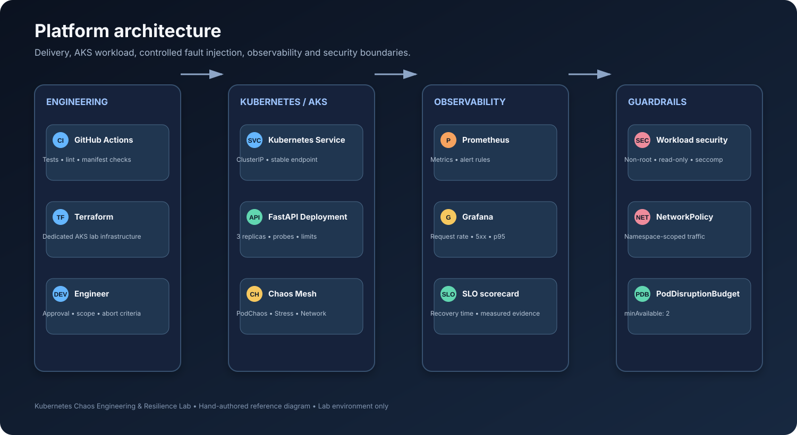
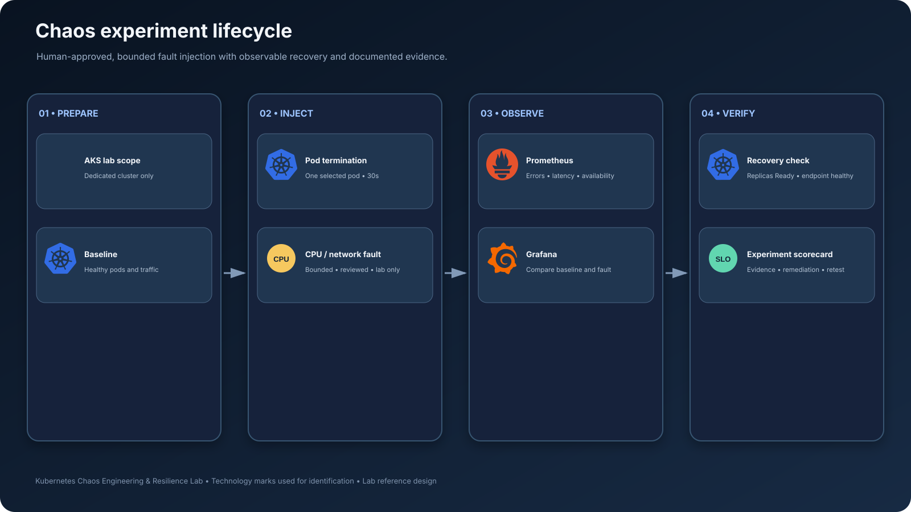
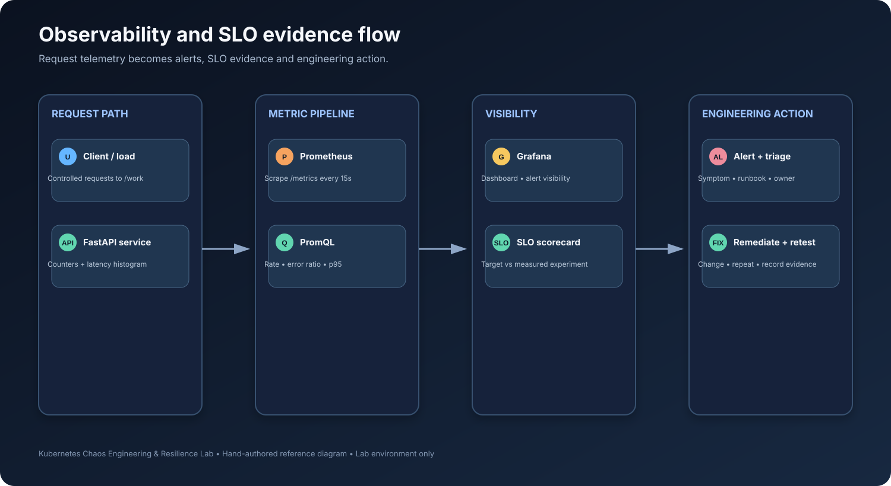

# Architecture and design

## Diagram set

These diagrams are maintained as source files in this repository. SVGs are rendered previews for GitHub; matching `.drawio` files are editable in [diagrams.net](https://app.diagrams.net/).

### 1. Platform architecture

[Open editable source](diagrams/01-platform-architecture.drawio)

### 2. Chaos experiment lifecycle

[Open editable source](diagrams/02-chaos-experiment-lifecycle.drawio)

### 3. Observability and SLO evidence flow

[Open editable source](diagrams/03-observability-and-slo-flow.drawio)

## System purpose

The lab validates recovery behavior of a deliberately small Kubernetes workload. It is not a production chaos platform and does not include automatic production fault injection.

## Logical components

1. **Engineering and delivery:** GitHub Actions validates source, Python tests, Kubernetes manifests and Terraform configuration. Terraform provisions a dedicated AKS lab cluster.
2. **Workload plane:** FastAPI runs as three replicas behind a ClusterIP Service in the `resilience-lab` namespace.
3. **Fault plane:** Chaos Mesh injects a single, time-bounded fault into label-selected pods in the dedicated namespace.
4. **Telemetry plane:** Prometheus scrapes request counters and latency histograms; Grafana visualizes request rate, error ratio and p95 latency.
5. **Reliability evidence:** An experiment scorecard records baseline, impact, recovery time, SLO outcome and remediation.

## Trust boundaries and guardrails

- Use a disposable cluster dedicated to this lab. Never target production or shared workloads.
- The sample API does not need Kubernetes API access; service-account token automount is disabled.
- Chaos Mesh controllers require powerful permissions. Restrict installation and experiment creation to trusted administrators.
- Every experiment must use a dedicated namespace, narrow label selectors, bounded duration and documented abort conditions.
- NetworkPolicies require a compatible CNI. Validate DNS, scrape traffic and application paths before enforcement.
- The Terraform starter creates billable Azure resources. Review subscription, region, quotas and plan before applying.

## Design decisions

- Three replicas make replacement and availability behavior observable; they do not guarantee resilience on their own.
- Readiness probes control traffic eligibility; liveness probes restart an unhealthy process. Poor probe design can create restart loops.
- Requests and limits provide explicit scheduling and resource boundaries. Tune them from measured workload data.
- A PodDisruptionBudget protects against some voluntary disruptions, not node failure or simultaneous application failure.
- SLO values in this repository are illustrative targets. Only measured experiment evidence can establish whether a target passed.
